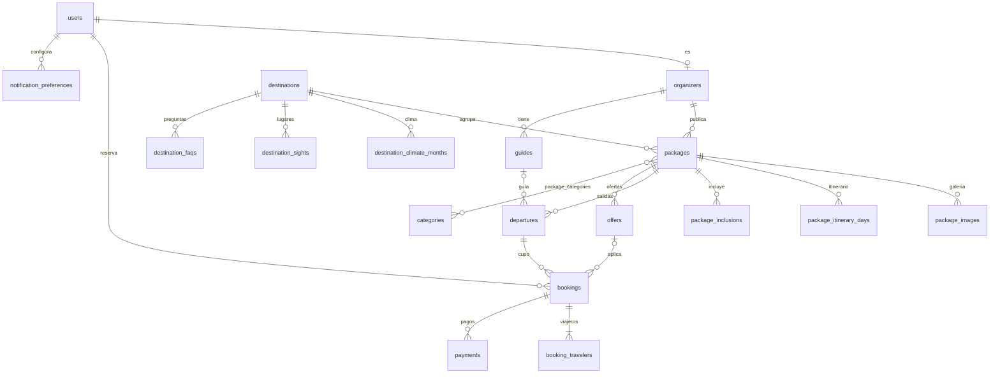

# ERM

Modelo entidad-relación de Wayra (Postgres en Neon, Drizzle). Sacado del artefacto de diseño. Leer al **tocar la base de datos**: schema, migraciones, services o queries.
Reglas de carpetas: [ARCHITECTURE.md](ARCHITECTURE.md). Flujos de reserva y pago: [SYSTEM-DESIGN.md](SYSTEM-DESIGN.md).

Convenciones: ids `uuid`, columnas `snake_case`, dinero en céntimos (`*_cents`, `integer`) con `currency` (`PEN`), fechas `timestamptz`.

## Diagrama

## Enums

| Enum                | Valores                                                          |
| ------------------- | ---------------------------------------------------------------- |
| `user_role`         | `super_admin`, `admin`, `organizer`, `customer`                  |
| `organizer_status`  | `pending`, `active`, `suspended`                                 |
| `package_kind`      | `package`, `day_tour`                                            |
| `publish_status`    | `draft`, `published`                                             |
| `inclusion_kind`    | `included`, `excluded`                                           |
| `season`            | `dry`, `mixed`, `rainy`                                          |
| `departure_status`  | `scheduled`, `en_route`, `completed`, `cancelled`                |
| `offer_kind`        | `last_minute`, `rainy_season`, `groups`                          |
| `discount_type`     | `percent`, `two_for_one`                                         |
| `booking_status`    | `pending`, `confirmed`, `cancelled`                              |
| `doc_type`          | `dni`, `passport`, `foreign_id` (carné de extranjería)           |
| `payment_method`    | `card`, `yape`, `plin`, `cash` (solo `card` se implementa en v1) |
| `payment_status`    | `pending`, `succeeded`, `failed`, `refunded`, `partially_refunded` |
| `notification_key`  | `new_booking`, `cancellations`, `weekly_summary`                 |

## Entidades

### Identidad

**users** — espejo de Clerk; la fuente de verdad de la sesión es Clerk.
`id`, `clerk_id` (unique), `email`, `first_name`, `last_name`, `phone`, `country`, `role` (`user_role`, default `customer`), `created_at`.

**organizers** — perfil del operador (panel: "Datos de la empresa").
`id`, `user_id` (unique, fk), `business_name` (razón social), `ruc`, `whatsapp`, `status` (`organizer_status`, default `pending`; lo activa un admin), `created_at`.

**notification_preferences** — switches de "Notificaciones" del panel.
pk (`user_id`, `key`), `key` (`notification_key`), `enabled`.

### Catálogo

**destinations** — pantalla Destino.
`id`, `slug` (unique), `name`, `region`, `tagline`, `description`, `altitude_m`, `best_season_text`, `from_lima_text`, `hero_image_url`.
- **destination_climate_months**: pk (`destination_id`, `month` 1–12), `season`. Alimenta la barra "Cuándo viajar".
- **destination_sights**: `id`, `destination_id`, `name`, `description`, `image_url`, `sort_order`. ("Lo imperdible")
- **destination_faqs**: `id`, `destination_id`, `question`, `answer`, `sort_order`.

**categories** — Aventura, Cultura, Naturaleza, Gastronomía, Playas. "Un día" **no** es categoría: se deriva de `kind = day_tour` o `duration_days = 1`.
`id`, `slug` (unique), `name`. Relación N:M con `packages` vía **package_categories** (`package_id`, `category_id`).

**packages** — una sola tabla para paquetes y tours de un día.
`id`, `organizer_id`, `destination_id`, `kind`, `slug` (unique), `title`, `blurb` (resumen de tarjeta), `description`, `duration_days`, `nights`, `duration_hours` (tours), `start_time` (tours: "4:00 a. m."), `price_cents` (por persona, habitación doble), `currency`, `max_group_size`, `languages` (`text[]`), `meeting_point`, `meeting_lat`, `meeting_lng`, `cover_image_url`, `status` (`publish_status`, default `draft`), `created_at`, `updated_at`.
- **package_images**: `id`, `package_id`, `url`, `alt`, `credit` (crédito de foto, licencias CC), `sort_order`. (galería)
- **package_itinerary_days**: `id`, `package_id`, `day_number`, `title`, `description`, `place`, `transport_leg` ("Tren panorámico · 1 h 40 min"), `image_url`, `lat`, `lng`. (itinerario y mapa)
- **package_inclusions**: `id`, `package_id`, `kind`, `text`, `sort_order`. ("Incluye" / "No incluye")

**guides** — `id`, `organizer_id`, `name`, `phone`.

**departures** — fechas concretas con cupo; alimenta el selector de fecha y "Salidas de hoy".
`id`, `package_id`, `guide_id` (nullable), `starts_at`, `capacity`, `booked_seats` (default 0), `status` (`departure_status`). Unique (`package_id`, `starts_at`). Check `booked_seats <= capacity`.

**offers** — pantalla Ofertas.
`id`, `package_id`, `kind`, `discount_type`, `discount_value` (porcentaje; null si `two_for_one`), `min_people` (null; "Desde 4 personas"), `valid_until`, `is_active`, `created_at`. El precio con oferta se calcula, no se guarda.

### Reservas y pagos

**bookings**
`id`, `code` (unique, `WY-####` desde una secuencia de Postgres), `customer_id` (fk users), `package_id`, `departure_id`, `offer_id` (nullable), `status` (`booking_status`, default `pending`), `pax_count`, `unit_price_cents` (**snapshot** del precio al reservar), `discount_cents`, `total_cents`, `currency`, `contact_email`, `contact_phone`, `terms_accepted_at`, `cancelled_at`, `created_at`.

**booking_travelers** — "Viajero principal" del pago; el resto se completa después (la entrada a Machu Picchu exige nombre y documento de todos).
`id`, `booking_id`, `first_name`, `last_name`, `doc_type`, `doc_number`, `is_primary`.

**payments**
`id`, `booking_id`, `provider` (`stripe`), `method` (`payment_method`), `status` (`payment_status`), `amount_cents`, `currency`, `stripe_checkout_session_id` (unique), `stripe_payment_intent_id`, `refunded_cents` (default 0), `paid_at`, `created_at`.

**stripe_events** — idempotencia de webhooks. `id` (pk = id del evento de Stripe), `type`, `processed_at`.

### Marketing

**newsletter_subscribers** — "Recibe las ofertas antes que nadie". `id`, `email` (unique), `subscribed_at`, `unsubscribed_at`.

## Derivado (no es tabla)

| Dato del panel admin                     | Cómo se calcula                                                           |
| ---------------------------------------- | ------------------------------------------------------------------------- |
| Ingresos del mes, ticket promedio        | `sum` y `avg` de `bookings.total_cents` con `status = confirmed`, por mes |
| Reservas, cancelaciones (%)              | `count` de `bookings` por estado y mes                                    |
| Destinos más vendidos                    | `bookings` → `packages` → `destinations`, agrupado                        |
| Lista de clientes (reservas, gasto, última) | `users` + agregados de `bookings` confirmadas                          |
| Paquetes vendidos en el mes              | `count` de `bookings` por `package_id`                                    |
| Salidas de hoy (viajeros)                | `departures` del día con `booked_seats`                                   |

## Reglas de datos

- **Cupo:** al confirmar, `update departures set booked_seats = booked_seats + :pax where id = :id and booked_seats + :pax <= capacity` dentro de la misma transacción que confirma la reserva y el pago. Si no actualiza ninguna fila, no hay cupo.
- **Cancelación:** gratis hasta 48 h antes de `departures.starts_at`; después, `refunded_cents` retiene el costo de las entradas ya emitidas. Al cancelar se devuelve el cupo.
- **Snapshot:** precios y descuentos se copian a `bookings`; cambios posteriores en `packages` u `offers` no alteran reservas existentes.
- **Publicación:** solo `packages.status = published` se ve en el sitio público.
- **Alcance por rol:** un `organizer` solo accede a filas cuyo `organizer_id` (directo o vía `package_id`) sea el suyo.

## Matriz rol × entidad

C = crear, R = leer, U = actualizar, D = borrar, `·` = sin acceso, (propio) = solo sus filas.

| Entidad                         | super_admin | admin | organizer        | customer         | público |
| ------------------------------- | ----------- | ----- | ---------------- | ---------------- | ------- |
| users                           | CRUD        | R     | R (sus clientes) | RU (propio)      | ·       |
| organizers                      | CRUD        | CRU   | RU (propio)      | ·                | ·       |
| destinations (+ hijas)          | CRUD        | CRUD  | R                | R                | R       |
| categories                      | CRUD        | CRUD  | R                | R                | R       |
| packages (+ hijas), guides      | CRUD        | CRUD  | CRUD (propio)    | R (publicados)   | R (publicados) |
| departures                      | CRUD        | CRUD  | CRUD (propio)    | R                | R       |
| offers                          | CRUD        | CRUD  | CRUD (propio)    | R (activas)      | R (activas) |
| bookings, booking_travelers     | CRUD        | RU    | R (sus paquetes) | CR (propio), U cancelar | · |
| payments                        | R           | R     | R (sus paquetes) | R (propio)       | ·       |
| stripe_events                   | R           | ·     | ·                | ·                | ·       |
| newsletter_subscribers          | CRUD        | R     | ·                | ·                | C       |
| notification_preferences        | RU (propio) | RU (propio) | RU (propio) | ·            | ·       |

`payments` y `stripe_events` los escribe solo el servidor (webhook), nunca el cliente.

## Trazabilidad: pantalla → entidades

| Pantalla del artefacto           | Entidades                                                              |
| -------------------------------- | ---------------------------------------------------------------------- |
| 1 Inicio                         | `packages` (destacados, categorías), `destinations`, `categories`      |
| 2 Paquetes                       | `packages`, `categories`, `package_images`; filtros por duración y tipo |
| 3 Tours de un día                | `packages` (`kind = day_tour`), `departures`, `destinations` (ciudad)  |
| 4 Ofertas                        | `offers`, `packages`, `newsletter_subscribers`                         |
| 5 Destino                        | `destinations`, `destination_*`, `packages`                            |
| 6 Detalle de paquete             | `packages`, `package_images`, `package_itinerary_days`, `package_inclusions`, `departures` |
| 7 Pago                           | `bookings`, `booking_travelers`, `payments`                            |
| 8 Confirmación                   | `bookings`, `packages` (`meeting_point`), `departures`                 |
| 9 Panel administrador            | `bookings`, `packages`, `users`, `offers`, `departures`, `guides`, `organizers`, `notification_preferences`, derivados |
