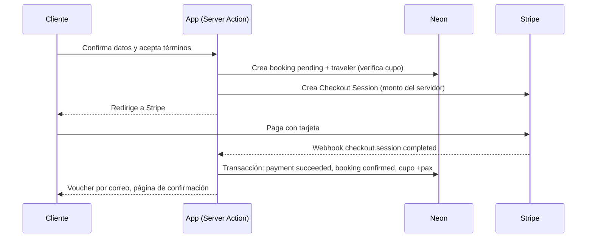

# SYSTEM-DESIGN

Arquitectura técnica de Wayra en producción. Leer al **tocar autenticación, pagos, webhooks, infraestructura, variables de entorno o despliegue**.
Datos: [ERM.md](ERM.md). Carpetas y rutas: [ARCHITECTURE.md](ARCHITECTURE.md).

## Stack

| Capa            | Tecnología                                                                 |
| --------------- | -------------------------------------------------------------------------- |
| App             | Next.js 16 (App Router), React 19, TypeScript estricto                     |
| UI              | Tailwind 4, shadcn/ui `base-nova` ([DESIGN-SYSTEM.md](DESIGN-SYSTEM.md))   |
| Estado y datos  | TanStack Query/Table, Zustand (solo cliente), Zod                          |
| Base de datos   | Postgres en **Neon** + **Drizzle** (driver serverless de Neon)             |
| Autenticación   | **Clerk**                                                                  |
| Pagos           | **Stripe** (Checkout alojado por Stripe, solo tarjeta en v1)               |
| Despliegue      | **Vercel** (preview por PR, producción desde `main`)                       |

## Contexto

```mermaid
flowchart LR
  B[Navegador] --> N[Next.js en Vercel]
  N -->|sesión, roles| C[Clerk]
  N -->|SQL| D[(Neon Postgres)]
  N -->|Checkout, reembolsos| S[Stripe]
  C -.webhook user.*.-> N
  S -.webhook payment.-> N
```

El navegador nunca habla con Neon ni con Stripe con claves secretas. Todo acceso a datos pasa por Server Components, Server Actions o route handlers.

## Autenticación y autorización

- **Roles:** `super_admin`, `admin`, `organizer`, `customer`. Se guardan en `publicMetadata.role` de Clerk y se reflejan en `users.role` por el webhook `user.created` / `user.updated`. Sin rol = `customer`.
- **Borde (proxy):** Clerk protege las rutas por grupo según la tabla de [ARCHITECTURE.md](ARCHITECTURE.md#4-rutas-por-rol). En Next 16 este archivo puede llamarse `proxy.ts` en vez de `middleware.ts`; confirmar en `node_modules/next/dist/docs/` antes de crearlo.
- **No alcanza con el borde.** Cada Server Action y route handler vuelve a validar sesión y rol con un guard de `lib/auth` (`requireRole("admin")`). El rol viene del token de Clerk, nunca de un parámetro del cliente.
- **Alcance de datos:** el rol `organizer` filtra siempre por su `organizer_id` en el service, no en el componente.
- **Alta de roles:** solo `super_admin` crea administradores; un `admin` activa operadores (`organizers.status`). El cliente se registra solo.

## Reserva y pago



Reglas:
- **El monto lo calcula el servidor** desde `packages`, `offers` y `pax_count`; nunca se confía en el precio del cliente.
- **Idempotencia:** cada evento de Stripe se registra en `stripe_events`; si el `id` ya existe, se ignora.
- **Firma:** el webhook verifica la firma de Stripe con el cuerpo crudo antes de tocar la base.
- **Cupo:** se descuenta con `update ... where booked_seats + pax <= capacity` dentro de la transacción de confirmación (ver [ERM.md](ERM.md#reglas-de-datos)). Si falla (carrera), se reembolsa y la reserva pasa a `cancelled`.
- **Reservas `pending` sin pago** expiran (la Checkout Session vence); un job las cancela.
- **Cancelación:** gratis hasta 48 h antes de la salida; el reembolso se hace con la API de Stripe y actualiza `payments.refunded_cents` por el webhook `charge.refunded`.
- **Otros métodos** (Yape, Plin, PagoEfectivo): fuera de v1. El enum ya los contempla.

## Webhooks

| Origen | Ruta                         | Eventos                                                              | Verificación          |
| ------ | ---------------------------- | -------------------------------------------------------------------- | --------------------- |
| Clerk  | `/api/webhooks/clerk`        | `user.created`, `user.updated`, `user.deleted`                       | Svix (firma)          |
| Stripe | `/api/webhooks/stripe`       | `checkout.session.completed`, `checkout.session.expired`, `charge.refunded` | `Stripe-Signature` |

Los handlers responden rápido (2xx) y son idempotentes.

## Datos

- **Drizzle** define el schema en `lib/db` y genera las migraciones (`drizzle-kit`). Las migraciones se versionan en el repo.
- **Neon:** rama de base de datos por preview de Vercel y rama principal para producción; la conexión usa el endpoint *pooled*.
- **Catálogo público** (paquetes, destinos, ofertas): se cachea en servidor y se invalida al publicar o editar (Cache Components de Next 16). Reservas, pagos y paneles son dinámicos, sin caché compartida.

## Variables de entorno

Solo nombres; los valores van en Vercel y en `.env.local` (ignorado por git).

| Variable                              | Uso                              |
| ------------------------------------- | -------------------------------- |
| `DATABASE_URL`                        | Neon (pooled)                    |
| `DATABASE_URL_UNPOOLED`               | Neon, migraciones                |
| `NEXT_PUBLIC_CLERK_PUBLISHABLE_KEY`   | Clerk, cliente                   |
| `CLERK_SECRET_KEY`                    | Clerk, servidor                  |
| `CLERK_WEBHOOK_SIGNING_SECRET`        | Webhook de Clerk                 |
| `STRIPE_SECRET_KEY`                   | Stripe, servidor                 |
| `STRIPE_WEBHOOK_SECRET`               | Webhook de Stripe                |
| `NEXT_PUBLIC_APP_URL`                 | URLs de retorno de Checkout      |

## Entornos

| Entorno    | Origen              | Base de datos        | Claves                         |
| ---------- | ------------------- | -------------------- | ------------------------------ |
| Local      | `npm run dev`       | rama Neon de desarrollo | Clerk dev, Stripe test      |
| Preview    | cada PR en Vercel   | rama Neon por preview   | Clerk dev, Stripe test      |
| Producción | `main`              | rama Neon principal     | Clerk prod, Stripe live     |

## Seguridad y operación

- Validar toda entrada con Zod en el borde de cada Server Action y route handler.
- Documento y datos de viajeros son datos personales: solo los ven el cliente dueño, el operador del paquete y los administradores.
- Sin secretos en el repo (es público). Claves de Stripe live solo en Vercel producción.
- Logs de Vercel para errores; registrar el `id` de evento de Stripe en cada fallo de webhook.
- Accesibilidad y rendimiento: ver [DESIGN-SYSTEM.md](DESIGN-SYSTEM.md).

## Preguntas abiertas

1. **Stripe y soles:** confirmar el país de la cuenta de Stripe y si se puede cobrar y liquidar en `PEN`; si no, definir la moneda de cobro.
2. **Voucher y avisos:** proveedor de correo (propuesta: Resend) y de WhatsApp. El artefacto promete ambos.
3. **Imágenes:** hoy son fotos de Wikimedia Commons con licencias CC (requieren crédito, ya modelado en `package_images.credit`). Definir hosting propio (Vercel Blob) cuando los operadores suban fotos.
4. **Invitados:** la v1 exige cuenta para reservar (hay "Mis reservas"). Reservar sin cuenta queda fuera.
